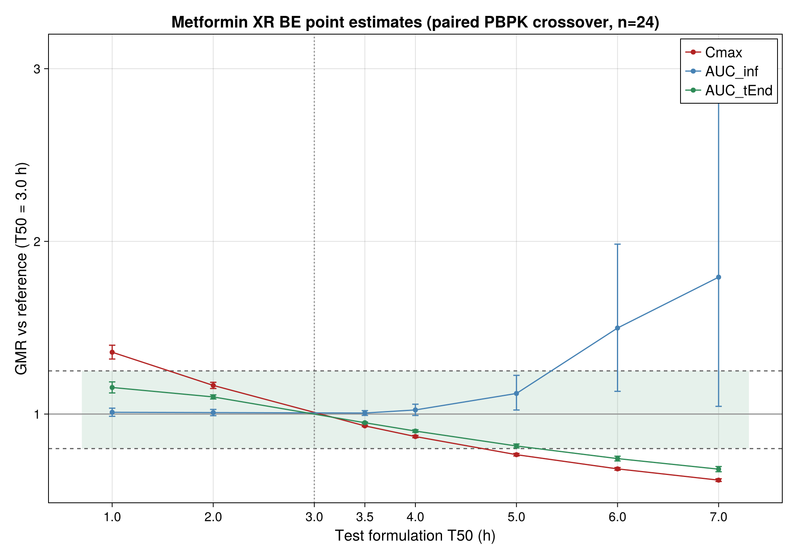
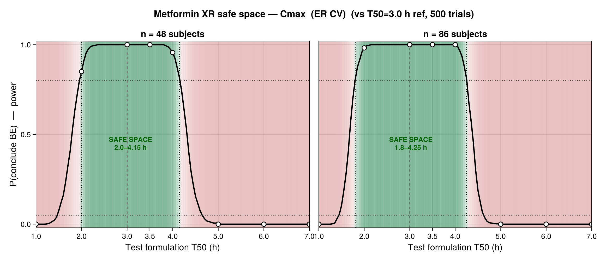
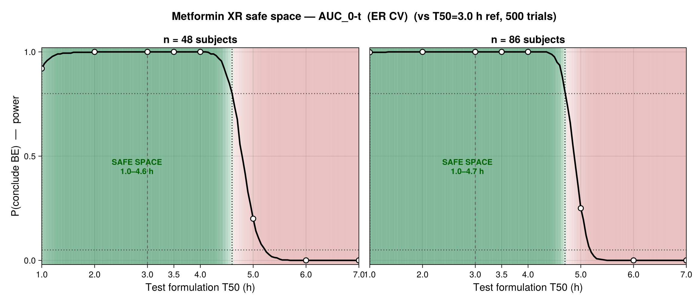
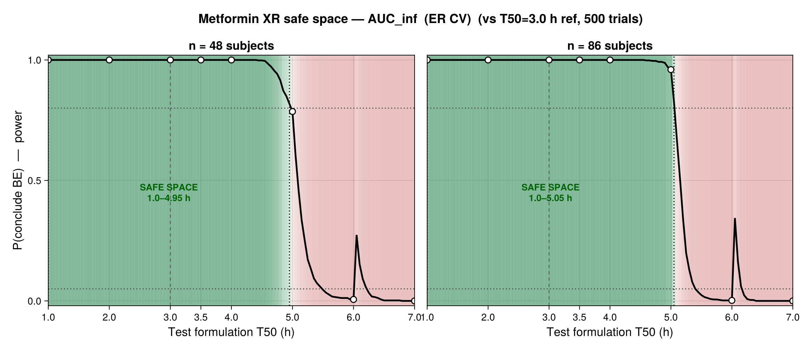
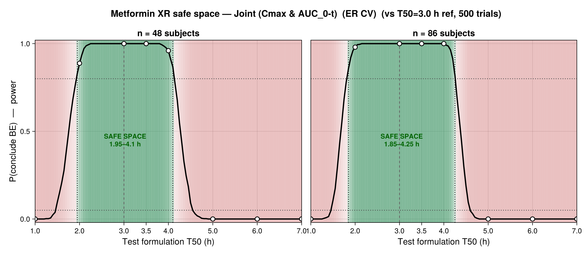

```{julia}
#| label: setup
#| echo: false
using CSV, DataFrames, Statistics, Printf, CairoMakie
include(joinpath(@__DIR__, "julia", "be_utils.jl"))
using .BEUtils
OUT = joinpath(@__DIR__, "output")

# Minimal GitHub-flavoured markdown table emitter (publication-quality static
# tables with caption + cross-ref label). Use under `#| output: asis`.
function md_table(df; caption = "", label = "")
    cols = string.(names(df))
    io = IOBuffer()
    println(io, "| " * join(cols, " | ") * " |")
    println(io, "| " * join(fill("---", length(cols)), " | ") * " |")
    for r in eachrow(df)
        println(io, "| " * join([string(r[c]) for c in names(df)], " | ") * " |")
    end
    if !isempty(caption)
        println(io)
        println(io, ": " * caption * (isempty(label) ? "" : " {#tbl-$label}"))
    end
    print(String(take!(io)))
end
pct(x) = @sprintf("%.1f%%", 100x)
nothing
```

## Background

This report defines the **bioequivalence (BE) safe space** of metformin extended-release
(XR) formulations from a validated PK-Sim PBPK model (Open Systems Pharmacology metformin
model). Formulation behaviour is varied through the in-vivo dissolution half-time **`T50`**:
small `T50` releases fast (higher, earlier C~max~); large `T50` releases slowly.

The **reference formulation is `T50 = 3.0 h`**; every other formulation
(`T50` = 1, 2, 3.5, 4, 5, 6, 7 h) is a **test** product assessed against it.

Two analyses are reported:

1. **Point average BE** — the regulatory **CI-based** decision: BE if the **90% CI of the
   GMR** for both C~max~ and AUC lies within **80–125%**.
2. **Virtual BE (VBE)** — resampled `n`-subject crossover trials give the **probability** a
   real study concludes BE. This curve *is* the safe space; in truly non-equivalent regions
   its value *is* the **Type I error** (consumer risk).

### Design and settings

- **Paired crossover.** PK-Sim simulates the *same* virtual individuals (IDs 0–23) under
  every formulation → a fully paired 2×2 crossover (no period/sequence effect); we analyse
  within-subject log-differences (TOST).
- **VBE:** 500 replicate trials; study sizes **n = 48 and 86 subjects**. *Limitation:* the
  PBPK population has **24 unique** virtual subjects, so n>24 trials bootstrap with
  replacement from those 24 physiologies (between-subject diversity is capped at 24).
- **Metric note.** For XR products with heavy AUC extrapolation we lead with **AUC~0-t~**.
  AUC~∞~ is reported but unreliable for slow-release arms (long terminal t½ → large, uncertain
  extrapolation → wide CIs).
- **Tooling.** Julia + open Pumas-ecosystem packages (DataFrames, CSV, CairoMakie). Licensed
  Pumas `Bioequivalence`/`NCA` can be swapped in once the env is instantiated with a JuliaHub
  token; base-R scripts under `programs/R` are an independent cross-check (agree to all digits).

## PK metrics by formulation

```{julia}
#| label: tbl-pk
#| output: asis
#| echo: false
pk = CSV.read(joinpath(OUT, "pk_parameters_individual.csv"), DataFrame)
gm(x) = (v = collect(skipmissing(x)); v = v[isfinite.(v) .& (v .> 0)]; exp(mean(log.(v))))
g = combine(groupby(pk, :T50),
            nrow => :n,
            :Cmax => (x -> round(gm(x), digits = 2)) => :Cmax,
            :AUC_tEnd => (x -> round(gm(x), digits = 0)) => :AUC0t,
            :AUC_inf  => (x -> round(gm(x), digits = 0)) => :AUCinf)
rename!(g, :T50 => "T50 (h)", :Cmax => "GM Cmax (µmol/L)",
        :AUC0t => "GM AUC₀-t (µmol·min/L)", :AUCinf => "GM AUC∞ (µmol·min/L)")
md_table(g; caption = "Geometric-mean PK metrics by formulation (n = 24). The 3.0 h row is the reference.", label = "pk")
```

**Inference.** C~max~ falls monotonically as release slows (29.8 → 13.6 µmol/L), so it is the
BE-determining endpoint. AUC~0-t~ falls gently; AUC~∞~ is flat then *inflates* for the slow
arms (flip-flop kinetics) — a numerical artefact of extrapolation, not extra exposure.

## 1. Point average BE (90% CI decision)

```{julia}
#| label: tbl-be
#| output: asis
#| echo: false
be = CSV.read(joinpath(OUT, "be_table_publication.csv"), DataFrame)
md_table(be; caption = "Point average-BE vs the 3.0 h reference (paired crossover, n = 24). GMR with 90% CI (%); BE requires the CI ⊂ 80–125%. Overall BE = C~max~ and AUC₀-t both Pass.", label = "be")
```

{#fig-gmr width=85%}

**Inference.** The decision is **CI-based, not point-GMR-based**. C~max~ drives both edges:
fast release (1.0 h) breaches the *upper* limit (GMR 1.36, CI 131.9–139.9%); slow release
(≥5.0 h) breaches the *lower* limit. AUC~0-t~ fails only at the slow extreme; AUC~∞~ shows
spuriously wide CIs at 6–7 h from extrapolation. Formulations passing **both** C~max~ and
AUC~0-t~: **T50 = 2.0, 3.0 (ref), 3.5, 4.0 h**.

## 2. Within-subject variability (sourced)

Metformin is a **low-variability** drug. Intra-subject CVs adopted for the VBE simulation
(extended-release):

```{julia}
#| label: tbl-cv
#| output: asis
#| echo: false
cvt = DataFrame(
    "Source" => ["FDA NDA 212595 ClinPharm review (ER) — primary",
                 "Chung et al. 2018, Transl Clin Pharmacol 26(1):6–9 (ER)",
                 "Metformin IR tablets (literature) — high-variability bound"],
    "Cmax intra-CV" => ["12.2%", "14.3%", "≈23.7%"],
    "AUC intra-CV"  => ["11.2% (AUC₀-t), 11.4% (AUC∞)", "10.3%", "—"])
md_table(cvt; caption = "Sourced metformin within-subject (intra-subject) CV. The VBE uses the FDA ER values (C~max~ 12.2%, AUC₀-t 11.2%, AUC∞ 11.4%). Inter-subject CV for contrast: 18.4% / 20.6%.", label = "cv")
```

**Inference.** Because intra-subject CV is low (~11–12%), a modest study (n = 24–48) already
has high power to *detect* equivalence near the reference — the safe-space edges are
therefore set by the *true* formulation difference (C~max~ vs T50), not by trial noise.

## 3. VBE safe space by endpoint (500 trials; n = 48 and 86)

The safe space is the `T50` band where a trial reliably (power ≥ 80%) concludes BE. Green =
safe, red = fail; open circles are the 8 simulated formulations; the curve interpolates each
subject's response between them.

### C~max~ (BE-determining endpoint)

{#fig-cmax width=100%}

**Inference.** C~max~ gives the **narrowest** safe space (n=48: **2.00–4.15 h**; n=86:
**1.80–4.25 h**), so it governs the overall decision. Increasing n from 48→86 widens the band
only slightly (≈0.3 h) — consistent with low intra-subject CV: power near the edges is already
high, and the edges are driven by the true GMR crossing 80/125%, which more subjects cannot move.

### AUC~0-t~

{#fig-auc0t width=100%}

**Inference.** AUC~0-t~ is more permissive (≈**1.0–4.6/4.7 h**): exposure changes less than peak
with release rate, so only the slow extreme fails. It never limits the joint decision on the
fast side.

### AUC~∞~

{#fig-aucinf width=100%}

**Inference.** AUC~∞~ appears widest (≈**1.0–5.0 h**) but this is **not reliable**: for slow
arms the long terminal t½ forces heavy, uncertain extrapolation (and dropped subjects at
7 h), inflating the GMR and CI. AUC~∞~ should not drive the XR safe space — use AUC~0-t~.

### Joint decision (C~max~ & AUC~0-t~)

{#fig-joint width=100%}

**Inference.** The regulatory safe space is the joint pass region, which equals the C~max~ band
(C~max~ is limiting): **n=48 ≈ 1.95–4.10 h, n=86 ≈ 1.85–4.25 h** around the 3.0 h reference.

### Safe-space boundaries and VBE pass-rates

```{julia}
#| label: tbl-bounds
#| output: asis
#| echo: false
b = CSV.read(joinpath(OUT, "safe_space_boundaries.csv"), DataFrame)
b.range = [@sprintf("%.2f–%.2f h", r.ss_lo, r.ss_hi) for r in eachrow(b)]
w = unstack(select(b, [:endpoint, :n_subj, :range]), :endpoint, :n_subj, :range;
            renamecols = c -> "n = $c")
rename!(w, :endpoint => "Endpoint")
md_table(w; caption = "Safe-space T50 range (power ≥ 80%) by endpoint and study size.", label = "bounds")
```

```{julia}
#| label: tbl-power
#| output: asis
#| echo: false
v = CSV.read(joinpath(OUT, "vbe_trial_results.csv"), DataFrame)
v.col = string.(v.metric, " n", v.n_subj)
v.p   = pct.(v.pass_rate)
pw = unstack(select(v, [:T50, :col, :p]), :T50, :col, :p)
ord = ["T50", "Cmax n48", "Cmax n86", "AUC_tEnd n48", "AUC_tEnd n86", "AUC_inf n48", "AUC_inf n86"]
pw = pw[:, intersect(ord, names(pw))]
rename!(pw, "T50" => "Test T50 (h)")
md_table(pw; caption = "VBE pass-rate = P(conclude BE), 500 trials. Inside the safe space this is POWER; where the true GMR is outside 80–125% it is the TYPE I error (target ≤ 5%).", label = "power")
```

**Inference.** Pass-rates are ~100% inside the safe space and collapse to **0–0.6%** at the
truly non-equivalent slow arms (6–7 h) — Type I error is **well controlled** (≤ 5%). The
borderline arms (5 h AUC) show the expected power gain with n (e.g. AUC~∞~ 78.6% → 96.0%).

## Conclusions

```{julia}
#| label: conclude
#| output: asis
#| echo: false
summ = CSV.read(joinpath(OUT, "safe_space_summary.csv"), DataFrame)
be_t50 = sort([REF_T50; summ.T50[summ.overall_BE]])
println("- **Reference:** T50 = ", REF_T50, " h.")
println("- **Point-BE safe set (simulated formulations):** T50 = ", join(be_t50, ", "), " h (C~max~ & AUC₀-t, 90% CI ⊂ 80–125%).")
println("- **Continuous VBE safe space (joint, power ≥ 80%):** ≈ 1.9–4.1 h (n = 48), 1.85–4.25 h (n = 86).")
```

- **C~max~ is the BE-determining endpoint**; AUC~0-t~ and (artefactually) AUC~∞~ are more permissive.
- Larger study size (48 → 86) widens the safe space only marginally — a signature of metformin's
  **low intra-subject variability**; the edges are set by the true formulation effect, not trial noise.
- **Type I error is controlled** (≤ 5%) at truly non-equivalent formulations.

### Next steps (per MAP)

- Fit the **PopPK** model to a sparsely-sampled, residual-error version of these PBPK profiles,
  repeat this VBE workflow, and overlay the PBPK vs PopPK safe-space curves (decision equivalence).
- Add the IR high-variability (≈23.7%) scenario to bracket the safe space under higher CV.
