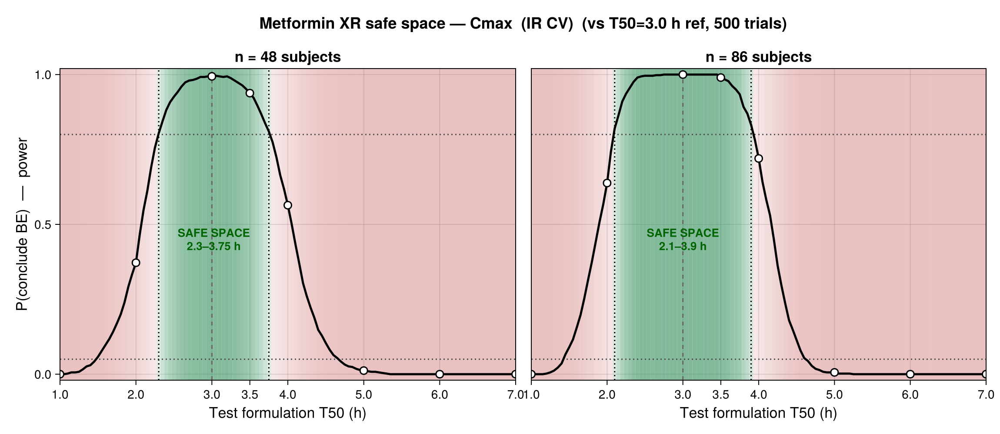
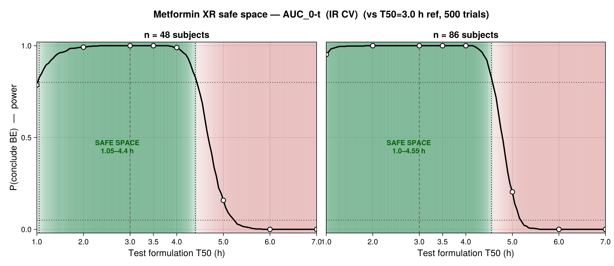
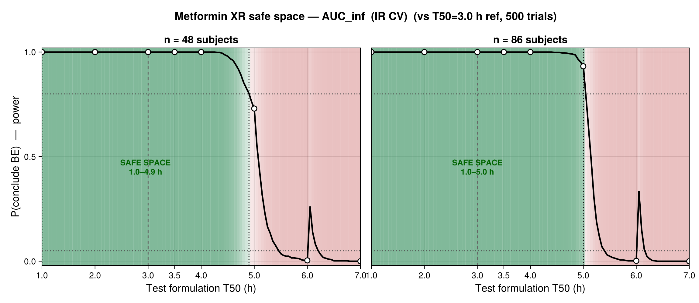
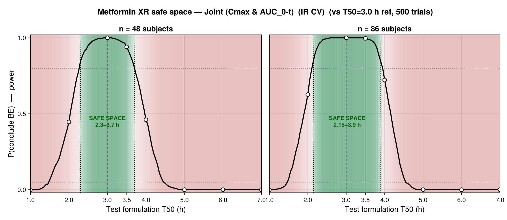

```{julia}
#| label: setup
#| echo: false
using CSV, DataFrames, Statistics, Printf, CairoMakie
include(joinpath(@__DIR__, "julia", "be_utils.jl"))
using .BEUtils
OUT = joinpath(@__DIR__, "output")

function md_table(df; caption = "", label = "")
    cols = string.(names(df))
    io = IOBuffer()
    println(io, "| " * join(cols, " | ") * " |")
    println(io, "| " * join(fill("---", length(cols)), " | ") * " |")
    for r in eachrow(df)
        println(io, "| " * join([string(r[c]) for c in names(df)], " | ") * " |")
    end
    if !isempty(caption)
        println(io); println(io, ": " * caption * (isempty(label) ? "" : " {#tbl-$label}"))
    end
    print(String(take!(io)))
end
pct(x) = @sprintf("%.1f%%", 100x)
nothing
```

## Purpose

This is a **sensitivity companion** to the main report (`be_safe_space_report.html`). It
repeats the virtual-bioequivalence (VBE) safe-space analysis — same PBPK population, same
3.0 h reference, same 500 trials at n = 48 and 86 — but substitutes the **higher
within-subject variability of metformin IMMEDIATE-release** for the extended-release values.
The question: *how much does the safe space shrink if the product behaved like a
higher-variability formulation?*

Metformin is a low-variability drug, but reported intra-subject CVs span a range. The IR /
upper-bound values used here bracket that range:

```{julia}
#| label: tbl-cv
#| output: asis
#| echo: false
cvt = DataFrame(
    "Scenario" => ["Main report — ER (FDA NDA 212595)", "This report — IR / high (sensitivity bound)"],
    "Cmax intra-CV" => ["12.2%", "23.7%"],
    "AUC intra-CV"  => ["11.2%", "14.7%"],
    "Basis" => ["metformin extended-release", "metformin IR tablets (22.7–25.7%, obs. 24.8%); AUC pooled 14.7%"])
md_table(cvt; caption = "Within-subject CV scenarios. This report uses the IR / high-variability row.", label = "cv")
```

> The point average-BE estimates (GMR and 90% CI) are **unchanged** from the main report —
> they are deterministic and do not depend on the assumed within-subject CV. Only the VBE
> *power* (and hence the safe-space width) changes. See the main report for the BE table.

## Safe space by endpoint (IR variability; 500 trials; n = 48 and 86)

Green = safe space (power ≥ 80%), red = fail; open circles = the 8 simulated formulations;
a tick marks every simulated T50.

### C~max~ (BE-determining endpoint)

{#fig-cmax width=100%}

**Inference.** Under IR variability the C~max~ safe space narrows sharply to **2.30–3.75 h**
(n=48) / **2.10–3.90 h** (n=86) — versus 2.00–4.15 / 1.80–4.25 h under ER. Higher trial noise
widens the 90% CI, so formulations farther from the reference can no longer pass reliably.

### AUC~0-t~

{#fig-auc0t width=100%}

**Inference.** AUC~0-t~ stays comparatively wide (~1.0–4.4/4.55 h): its lower assumed CV
(14.7%) and smaller true exposure change with release rate keep power high except at the slow
extreme. It does not limit the joint decision.

### AUC~∞~

{#fig-aucinf width=100%}

**Inference.** As in the main report, AUC~∞~ is **not reliable** for the slow arms
(extrapolation artefact) and should not drive the XR safe space.

### Joint decision (C~max~ & AUC~0-t~)

{#fig-joint width=100%}

**Inference.** The regulatory (joint) safe space contracts to **≈ 2.30–3.70 h (n=48)** /
**2.15–3.90 h (n=86)**, again governed by C~max~.

## ER vs IR safe-space comparison

```{julia}
#| label: tbl-compare
#| output: asis
#| echo: false
er = CSV.read(joinpath(OUT, "safe_space_boundaries.csv"), DataFrame)
ir = CSV.read(joinpath(OUT, "safe_space_boundaries_IR.csv"), DataFrame)
both = vcat(er, ir)
both.range = [@sprintf("%.2f–%.2f h", r.ss_lo, r.ss_hi) for r in eachrow(both)]
both.key = string.(both.scenario, " · n=", both.n_subj)
w = unstack(select(both, [:endpoint, :key, :range]), :endpoint, :key, :range)
rename!(w, :endpoint => "Endpoint")
ord = ["Endpoint", "ER · n=48", "IR CV · n=48", "ER · n=86", "IR CV · n=86"]
w = w[:, intersect(ord, names(w))]
md_table(w; caption = "Safe-space T50 range (power ≥ 80%): extended-release vs immediate-release within-subject CV. Higher CV (IR) narrows the safe space, most for the limiting C~max~/joint endpoints.", label = "compare")
```

```{julia}
#| label: tbl-power-ir
#| output: asis
#| echo: false
# Re-run VBE pass-rates under IR CV for the discrete simulated formulations.
pk = CSV.read(joinpath(OUT, "pk_parameters_individual.csv"), DataFrame)
ref = sort(filter(:T50 => ==(REF_T50), pk), :IndividualId)
ts  = sort(setdiff(unique(pk.T50), [REF_T50]))
rows = DataFrame()
for nss in N_SUBJ_LIST, tt in ts
    td = sort(filter(:T50 => ==(tt), pk), :IndividualId)
    for m in first.(BE_METRICS)
        r = vbe_replicate(td[!, m], ref[!, m]; n_subj = nss, n_trial = N_TRIAL_DEFAULT, wsv_cv = WSV_CV_IR[m])
        push!(rows, (T50 = tt, col = string(m, " n", nss), p = pct(r.pass_rate)))
    end
end
pw = unstack(rows, :T50, :col, :p)
ord = ["T50", "Cmax n48", "Cmax n86", "AUC_tEnd n48", "AUC_tEnd n86", "AUC_inf n48", "AUC_inf n86"]
pw = pw[:, intersect(ord, names(pw))]
rename!(pw, "T50" => "Test T50 (h)")
md_table(pw; caption = "VBE pass-rate under IR variability (500 trials). POWER inside the safe space; TYPE I error where the true GMR is outside 80–125% (target ≤ 5%).", label = "powerir")
```

**Inference.** Type I error remains controlled (≤ 5%) at the truly non-equivalent slow arms
even under higher variability. The cost of higher CV is **lost power near the edges**, which
is what contracts the safe space — not an increase in false-positive BE.

## Conclusion

Raising within-subject variability from ER (~12%) to IR/high (~24% C~max~) **narrows the joint
safe space by roughly 0.4–0.5 h on each side** (≈1.95–4.10 h → ≈2.30–3.70 h at n=48). The
qualitative findings are unchanged: C~max~ is limiting, AUC₀-t is permissive, AUC~∞~ is
artefactual, and Type I error stays controlled. A higher-variability product therefore
demands a **tighter formulation T50 tolerance** to remain bioequivalent to the 3.0 h reference.
