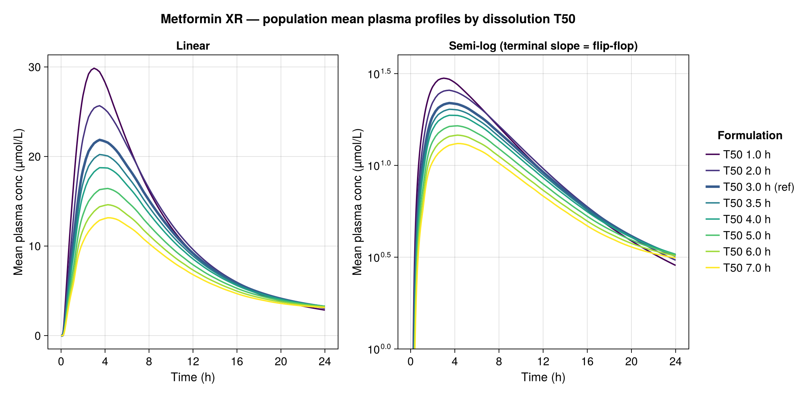
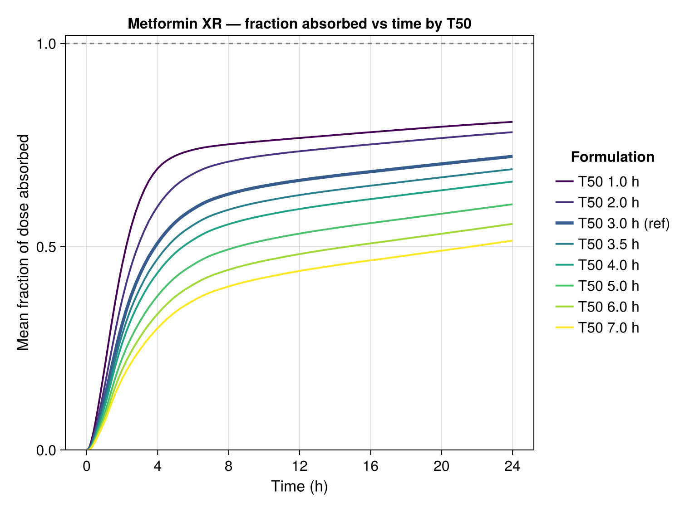

```{julia}
#| label: setup
#| echo: false
using CSV, DataFrames, Statistics, Printf, CairoMakie
include(joinpath(@__DIR__, "julia", "be_utils.jl"))
using .BEUtils
OUT = joinpath(@__DIR__, "output")

function md_table(df; caption = "", label = "")
    cols = string.(names(df))
    io = IOBuffer()
    println(io, "| " * join(cols, " | ") * " |")
    println(io, "| " * join(fill("---", length(cols)), " | ") * " |")
    for r in eachrow(df)
        println(io, "| " * join([string(r[c]) for c in names(df)], " | ") * " |")
    end
    if !isempty(caption)
        println(io); println(io, ": " * caption * (isempty(label) ? "" : " {#tbl-$label}"))
    end
    print(String(take!(io)))
end
nothing
```

## Purpose

This report shows the **population mean plasma concentration–time profiles** of metformin XR
across the dissolution-`T50` sweep (1–7 h) and uses them to explain two features seen in the
PK-parameter sweep:

1. **AUC∞ behaves erratically (inflates, with exploding CIs) at high T50.**
2. **Tmax stops increasing — it plateaus (~4–5 h) — at high T50.**

Both trace to the same physiology: as release slows, metformin enters **flip-flop kinetics**
and runs up against its **finite intestinal absorption window**.

## Mean concentration–time profiles (all T50 overlaid)

{#fig-prof width=100%}

**Inference.** As T50 increases the peak **falls and broadens** (linear panel) — slower input
spreads the same-ish amount of drug over more time. The **semi-log panel is the key**: the
fast-release curves (purple) show a clear, steep terminal decline (true elimination), whereas
the slow-release curves (yellow/green) are **flat in the tail and actually cross *above* the
fast curves by 24 h**. A terminal slope that *flattens with slower release* is the textbook
signature of **flip-flop kinetics** — the tail is now governed by ongoing slow absorption, not
elimination.

```{julia}
#| label: tbl-prof
#| output: asis
#| echo: false
d = CSV.read(joinpath(OUT, "profile_diagnostics.csv"), DataFrame)
disp = DataFrame(
    "T50 (h)" => d.T50,
    "Mean Cmax (µmol/L)" => round.(d.Cmax, digits = 1),
    "Tmax of mean profile (h)" => round.(d.Tmax, digits = 2),
    "Conc @ 24 h (µmol/L)" => round.(d.Clast_24h, digits = 2),
    "Fraction absorbed @ 24 h" => [@sprintf("%.0f%%", 100x) for x in d.Fabs_24h])
md_table(disp; caption = "Diagnostics read off the population mean profile. Note Tmax plateaus at 4.25 h for T50 ≥ 5 h, the 24 h tail stays ≈3 µmol/L even as Cmax halves, and the absorbed fraction falls below 60%.", label = "prof")
```

**Inference.** Three things move together: Cmax halves (29.9 → 13.2), **Tmax saturates at
4.25 h**, and the **fraction absorbed by 24 h falls from 81% to 51%**. Meanwhile the 24 h
concentration barely changes (~2.9–3.3) — relative to a falling Cmax, the tail is increasingly
*sustained*, i.e. flip-flop.

## Fraction of dose absorbed over time

{#fig-fabs width=70%}

**Inference.** Every curve **plateaus below 1.0** — absorption is **incomplete**, and more so
the slower the release. Metformin is absorbed mainly in the **upper small intestine (a finite
absorption window)**; once the dosage form transits past that window, the still-undissolved
drug is **never absorbed**. Slow release therefore loses a growing fraction of the dose
(F: 81% → 51%), which is exactly why Cmax and AUC₀-t decline.

## Q1 — Why does AUC∞ go wild at high T50?

*(Note: it is **AUC∞** that misbehaves; **AUC₀-t** declines smoothly and is well behaved.)*

```{julia}
#| label: tbl-nca
#| output: asis
#| echo: false
nca = DataFrame(
    "T50 (h)" => [1,2,3,3.5,4,5,6,7],
    "Apparent t½ (h)" => [8.6,9.1,11.9,13.7,15.8,20.8,27.4,36.2],
    "% AUC extrapolated" => ["10%","11%","16%","20%","23%","31%","39%","47%"],
    "Vz/F (mL/kg)" => [1816,1941,2688,3176,3717,4941,6340,7919],
    "AUC∞ (µmol·min/L)" => [17642,17440,16434,16053,15803,15684,16066,17031],
    "AUC₀-t (µmol·min/L)" => [15872,15490,13739,12889,12126,10839,9806,8954])
md_table(nca; caption = "NCA diagnostics (typical reference subject, comp.csv). The terminal-phase metrics inflate with T50; AUC₀-t falls smoothly while AUC∞ wobbles and rises.", label = "nca")
```

**Mechanism.**

- **Flip-flop inflates the terminal half-life.** Metformin's true elimination t½ is ~6–9 h.
  As input slows below the elimination rate, the observed terminal slope reflects *absorption*,
  so the apparent t½ balloons (8.6 → **36 h**). Tell-tale: **CL/F stays flat (~2.5)** while
  **Vz/F quadruples** — because Vz/F = (CL/F)/λz and λz collapses; the volume isn't really changing.
- **λz is fitted on a phase that isn't truly terminal.** At T50 = 7 h the curve is still
  rising/flat at 24 h (the tail sits *above* the fast-release arms). NCA fits a shallow,
  ill-defined λz and extrapolates `Clast/λz` to infinity — and that tail is now **47% of AUC∞**.
  A 47% extrapolation off an unreliable λz is essentially noise, so AUC∞ and its between-subject
  CI **blow up** (population AUC∞ at 7 h had a 90% CI of ~[1.0, 3.1] and even produced
  non-finite t½/Vz/F for some subjects).
- **AUC∞ should be flat, so the rise is the giveaway.** AUC∞ = F·Dose/CL; CL is fixed and F
  *falls*, so a *true* AUC∞ can only stay flat or decline. Its apparent **rise** is purely the
  extrapolation artefact — not extra exposure.

**Consequence for the BE work:** we lead with **AUC₀-t**, which is truncation-honest and smooth.
To rescue AUC∞ for the slow arms, **re-run T50 ≥ 5 h out to ~72–96 h** so absorption completes
and a real terminal phase emerges (driving %-extrapolated back under ~20%).

## Q2 — Why does Tmax plateau (~4–5 h) at high T50?

**Mechanism.** Two effects, both visible above:

- **The peak becomes a broad plateau.** Spreading the input flattens the top of the curve
  (the ≥95%-of-Cmax window is several hours wide), so Tmax becomes a shallow, weakly-defined
  maximum that no longer tracks release rate.
- **Tmax is gated by the absorption window, not by dissolution.** Beyond a certain slowness the
  peak occurs around the time the dosage form **transits out of the upper-GI absorption site** —
  a roughly fixed ~4–5 h — regardless of how much slower the remaining drug dissolves. Past that
  point, slower release does **not** delay the peak; it simply leaves **more drug unabsorbed**
  (the falling F above), lowering Cmax and AUC₀-t while Tmax stays put.

## Summary

| Observation | Root cause |
|---|---|
| AUC∞ inflates / CIs explode at high T50 | Flip-flop → λz under-estimated → huge, unstable extrapolation off a 24 h record (47% extrapolated) |
| AUC₀-t declines smoothly | Truncation-honest; tracks the real (falling) absorbed exposure |
| Tmax plateaus ~4–5 h | Broad flat peak + absorption gated by intestinal transit window, not dissolution |
| Cmax and F fall with T50 | Slow release → growing un-absorbed fraction past the absorption window |

: Mechanistic summary {#tbl-summary}

**Bottom line.** Slow release pushes metformin into **flip-flop, window-limited absorption**.
Use **AUC₀-t** (not AUC∞) for the XR safe space; expect Tmax to saturate; and if AUC∞ is ever
required, extend the slow-arm simulation duration so the terminal phase is real.
